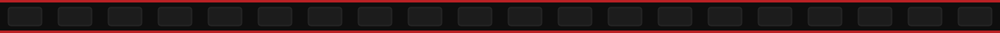
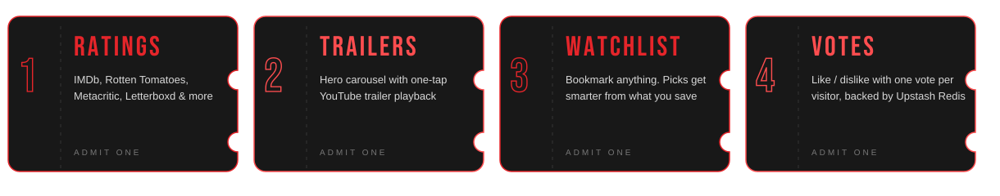
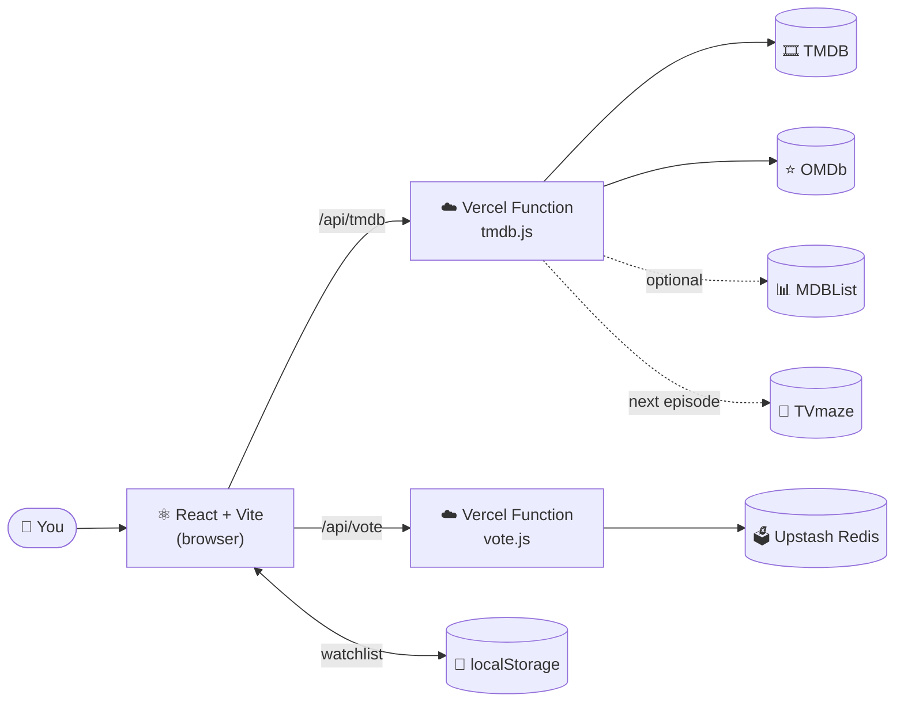

<div align="center">



<p>&nbsp;</p>

<a href="https://binge-iota.vercel.app"></a>


<p>&nbsp;</p>

<h3>Discover movies and series, check every rating in one place, and find your next watch.</h3>

<sub>
<a href="#-now-showing">Features</a> &nbsp;|&nbsp;
<a href="#-behind-the-screen">How it works</a> &nbsp;|&nbsp;
<a href="#-quick-start">Quick start</a> &nbsp;|&nbsp;
<a href="#-configuration">Config</a> &nbsp;|&nbsp;
<a href="#-project-structure">Structure</a> &nbsp;|&nbsp;
<a href="#-credits">Credits</a>
</sub>

<p>&nbsp;</p>

</div>



## 🎟 Now Showing

<div align="center">

</div>

<br/>

> 💡 **Tip:** tap any section below to expand it.

<details open>
<summary><b>🍿 &nbsp;Browse &amp; Discover</b></summary>

<br/>

| Tab | What you get |
| :-- | :-- |
| 🔥 **Trending** | Top 10 ranked row, personal recommendations and a popular grid |
| 🎞 **Movies** | Movies with the same ranked layout |
| 📺 **Series** | TV shows, including next-episode info |
| 🇮🇳 **Bollywood** | Hindi cinema, with Movies / Series sub-tabs |
| 🌸 **Anime** | Anime movies and series |
| 🔖 **Watchlist** | Everything you bookmarked, kept in your browser |

The hero carousel auto-advances with a live progress bar, a *Up Next* side panel, and one-tap trailer playback.

</details>

<details>
<summary><b>⭐ &nbsp;Ratings, all in one place</b></summary>

<br/>

Every title page pulls scores from several sources and merges them into one view:

- **IMDb**, **Rotten Tomatoes** and **Metacritic** (via OMDb)
- **TMDB** community score
- Optional extras through MDBList: **Letterboxd**, **Trakt**, **Rotten Tomatoes audience**, **Metacritic user**, **Roger Ebert**, **MyAnimeList**

Each card also carries a colour-coded **rating ring**: 🟢 high · 🟡 mixed · 🔴 low.

</details>

<details>
<summary><b>🎬 &nbsp;Title pages</b></summary>

<br/>

- ▶ Official trailer picked automatically (official trailer → trailer → teaser → clip)
- 📍 **Where to watch** (streaming providers)
- 🎭 Cast, 💬 user reviews, 🏷 keywords, 🖼 image gallery
- 🔁 Similar titles
- 📅 **Next episode** air date for running series (via TVmaze)

</details>

<details>
<summary><b>👍 &nbsp;Community votes</b></summary>

<br/>

Like or dislike any title. One vote per visitor; tap again to undo, or tap the other button to switch. Votes live in **Upstash Redis**, with per-IP rate limiting to stop vote-stuffing.

</details>

<details>
<summary><b>🔊 &nbsp;The intro</b></summary>

<br/>

A cinematic logo reveal with a sound sting **synthesized live with the Web Audio API**, so there are no audio files to download. It plays once per session. Want to see it again? Add `?intro` to the home URL:

```
https://binge-iota.vercel.app/?intro
```

</details>


## 🏗 Behind the Screen

Your API keys never reach the browser. Everything goes through a small serverless layer that hides the keys and caches responses.



**Good to know**

- 🔐 **Keys stay server-side.** Only the Vercel functions ever see them.
- ⚡ **Edge caching.** Lists are cached for 1 hour, title details for 24 hours (with stale-while-revalidate).
- 🛡 **Hardened headers.** `X-Frame-Options`, `nosniff`, a strict referrer policy and a locked-down permissions policy.
- 🧩 **Graceful failures.** Optional sources (MDBList, TVmaze) can fail without breaking a page.


## 🚀 Quick Start

<details open>
<summary><b>1️⃣ &nbsp;Run it locally</b></summary>

<br/>

```bash
# 1. Install
npm install

# 2. Add your keys
cp .env.example .env      # then fill in TMDB_KEY and OMDB_KEY

# 3. Start with the API (not plain `npm run dev`, which has no /api)
npx vercel dev
```

Get free keys here:

| Service | Where | Needed? |
| :-- | :-- | :-: |
| **TMDB** | [themoviedb.org](https://www.themoviedb.org) → Settings → API | ✅ |
| **OMDb** | [omdbapi.com](https://www.omdbapi.com) | ✅ |
| **MDBList** | [mdblist.com](https://mdblist.com) | optional |

> ⚠️ Never commit your `.env` file.

</details>

<details>
<summary><b>2️⃣ &nbsp;Deploy to Vercel</b></summary>

<br/>

1. Push the repo to GitHub.
2. Import it in [Vercel](https://vercel.com/new).
3. Add `TMDB_KEY` and `OMDB_KEY` (and optionally `MDBLIST_KEY`) under **Settings → Environment Variables**.
4. **Redeploy** after changing any environment variable.

</details>

<details>
<summary><b>3️⃣ &nbsp;Turn on voting</b></summary>

<br/>

1. In Vercel, open **Storage** and connect a free **Upstash Redis** database.
2. Vercel adds `KV_REST_API_URL` and `KV_REST_API_TOKEN` automatically.
3. Redeploy.

Without it, voting is disabled on the live site. (Locally it falls back to in-memory storage, which is fine for testing.)

</details>


## 🔑 Configuration

| Variable | Required | Purpose |
| :-- | :-: | :-- |
| `TMDB_KEY` | ✅ | Titles, posters, trailers, cast, providers |
| `OMDB_KEY` | ✅ | IMDb, Rotten Tomatoes and Metacritic scores |
| `MDBLIST_KEY` | ➖ | Extra rating sources (Letterboxd, Trakt, …) |
| `KV_REST_API_URL` / `KV_REST_API_TOKEN` | ➖ | Upstash Redis for votes (added by Vercel) |


## 🗂 Project Structure

```
Binge/
├── api/
│   ├── tmdb.js        # Serverless proxy: TMDB + OMDb + MDBList + TVmaze, with caching
│   └── vote.js        # Like / dislike votes, rate-limited, Upstash Redis
├── src/
│   ├── App.tsx        # Home: hero carousel, tabs, rows, search, watchlist
│   ├── Movie.tsx      # Movie detail page
│   ├── series.tsx     # Series detail page
│   ├── Intro.tsx      # Animated intro + Web Audio sting
│   ├── shared.tsx     # Shared helpers, vote buttons, trailer player
│   ├── styles.css     # All styling
│   └── main.tsx       # Entry point
├── public/            # Favicons
├── vercel.json        # Headers, rewrites, function limits
└── vite.config.ts
```


## 🎬 Credits

<div align="center">

**Designed & built by [Aniket Majumdar](mailto:aniketmajumdar2006@gmail.com)**

*Questions, bugs or feedback? Drop an email.*

<br/>

<sub>Movie and series data from <a href="https://www.themoviedb.org">TMDB</a> · ratings from <a href="https://www.omdbapi.com">OMDb</a> &amp; <a href="https://mdblist.com">MDBList</a> · episode data from <a href="https://www.tvmaze.com">TVmaze</a><br/>This product uses the TMDB API but is not endorsed or certified by TMDB.</sub>

<br/>

### 🍿 Find it. Rate it. Binge it.

</div>
